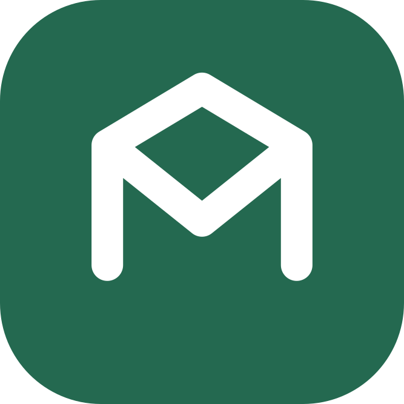
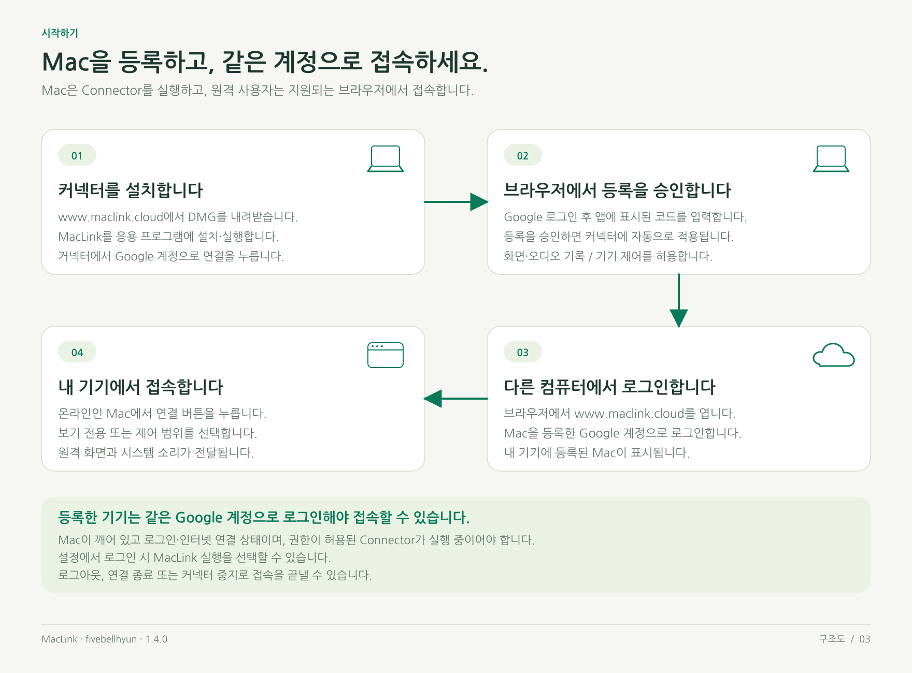
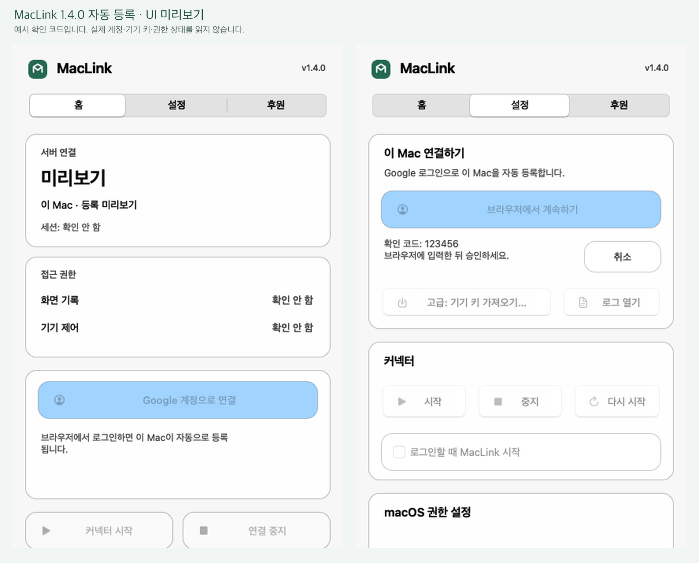
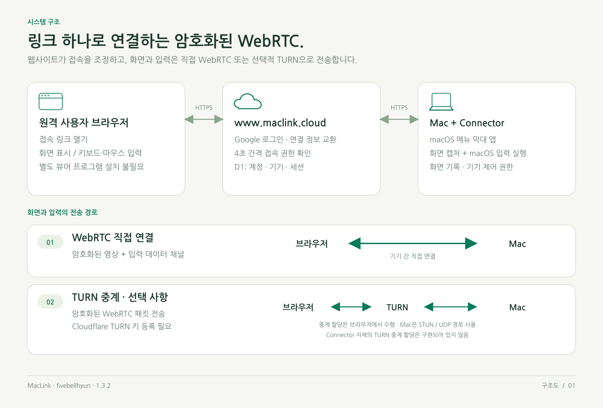
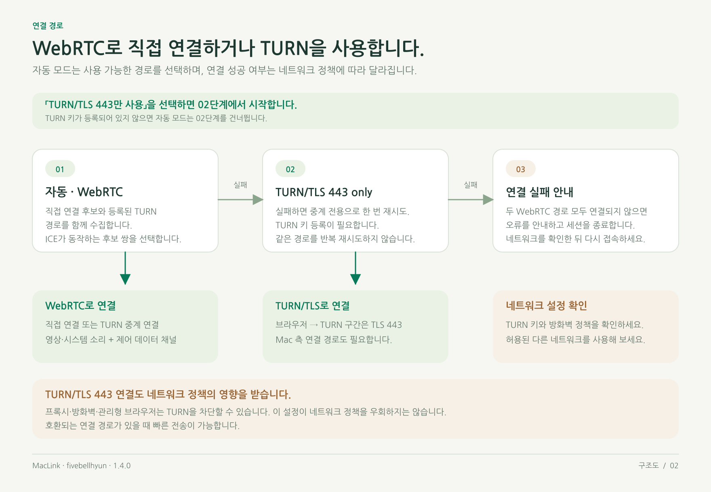

# MacLink

같은 Google 계정으로 어디서나 내 Mac에 접속하세요.

Mac에 커넥터를 설치하고 Google 계정에 기기를 등록하세요. 다른 컴퓨터에서 같은 계정으로 로그인한 뒤 **내 기기 → 연결**을 누르면 화면과 시스템 소리를 받고 마우스·키보드를 제어할 수 있습니다. 호스트 연결은 macOS 메뉴 막대 앱에서 관리합니다.

**커넥터 1.4.1** · [English](README.md) / **한국어**

[웹사이트](https://www.maclink.cloud/) · [커넥터 다운로드](https://www.maclink.cloud/api/downloads/MacLink-Connector-arm64.dmg) · [릴리스](https://github.com/fivebellhyun/MacLink/releases) · [라이선스](LICENSE.md) · [개인정보 처리방침](https://www.maclink.cloud/privacy) · [서비스 약관](https://www.maclink.cloud/terms)

개발: [fivebellhyun](https://github.com/fivebellhyun). 출처를 남길 경우 비상업적 용도로 소스를 수정 및 변형할 수 있습니다. 호스팅과 선택 사항인 TURN 서비스에는 별도 비용이 발생할 수 있습니다.

## 빠른 시작

1. [웹사이트](https://www.maclink.cloud/)에서 **MacLink 커넥터**를 받습니다. DMG를 열고 **MacLink**를 **응용 프로그램** 폴더로 옮긴 뒤 실행합니다.
2. 메뉴 막대 앱에서 **Google 계정으로 연결**을 누릅니다. 브라우저에 MacLink 등록 화면이 열립니다.
3. Google로 로그인하고, Mac 이름을 확인하고 커넥터에 표시된 여섯 자리 코드를 입력한 뒤 등록을 승인합니다.
4. macOS 시스템 설정에서 **화면 및 시스템 오디오 기록**과 **기기 제어 및 데이터 접근**을 허용하고, 안내가 나오면 커넥터를 다시 시작합니다. **내 기기**에서 온라인 상태가 될 때까지 기다립니다.
5. 다른 컴퓨터에서 **같은 Google 계정**으로 로그인하고, 온라인인 Mac의 **연결** 버튼을 누릅니다.

이미 설정한 커넥터는 재실행·업데이트해도 기존 등록을 유지합니다. 한 번도 연결되지 않은 기기는 일반 오프라인 기기와 구분해 **연결 설정 중**으로 표시됩니다.

원격 컴퓨터에는 호환되는 브라우저만 있으면 됩니다. 호스트 Mac은 **깨어있는 상태에서 커넥터가 실행 중이어야 합니다.**

현재 다운로드용 커넥터는 **macOS 13 이상**을 사용하는 **Apple M칩 시리즈 Mac(Apple silicon, arm64)**을 대상으로 합니다.

<details>
<summary>초기 설정 안내 이미지 보기</summary>



</details>

## 메뉴 막대 앱

macOS 메뉴 막대의 MacLink 아이콘에서 연결을 관리합니다.



*커넥터 1.4.1 자동 등록의 한글 UI 미리보기입니다. 예시 코드와 상태이며 실제 계정·권한·연결을 읽지 않습니다.*


| 탭   | 할 수 있는 작업                                                                                                                                                 |
| ---- | --------------------------------------------------------------------------------------------------------------------------------------------------------------- |
| 홈   | 서버 연결, 세션, 화면 기록·기기 제어 권한을 확인하고 다시 연결하거나 커넥터를 중지합니다.                                                                      |
| 설정 | Google 계정 연결, 로그 열기, 커넥터 시작·재시작, 로그인 시 실행, macOS 권한 설정 열기와 언어 선택을 지원합니다. 수동 키 가져오기는 개발용으로 남겨두었습니다.. |

MacLink의 **기기 제어**는 macOS의 **기기 제어 및 데이터 접근** 권한에 해당합니다. macOS 버전에 따라 화면 기록 권한은 **화면 및 시스템 오디오 기록**권한 입니다.

업데이트하려면 MacLink를 종료하고 설치된 앱을 최신 DMG의 앱으로 교체한 뒤 다시 실행하세요. 기기 설정은 `~/Library/Application Support/MacLink`에 저장됩니다. 빌드를 교체한 뒤 macOS에서 권한을 다시 허용해야 합니다.

현재 릴리스 빌드는 임시 서명(ad-hoc)을 사용하며 Developer ID 서명과 공증을 받지 않았습니다. macOS가 다운로드한 앱 실행을 차단하면 출처를 확인하고 **개인정보 보호 및 보안**의 일반 승인 절차를 사용하세요.

## 주요 기능


| 기능                | 설명                                                                                                                       |
| ------------------- | -------------------------------------------------------------------------------------------------------------------------- |
| 브라우저 접속       | 접속자용 앱을 설치하지 않고 Mac의 주 디스플레이를 보며 마우스·키보드 입력을 전달합니다.                                   |
| 메뉴 막대 커넥터    | macOS 앱에서 연결, 권한, 로그, 로그인 시 실행을 관리합니다.                                                                |
| 계정 기반 접속      | 등록한 Mac은 같은 Google 계정으로 로그인한 브라우저에서만 접속할 수 있습니다.                                              |
| 시스템 소리         | Mac의 시스템 오디오를 WebRTC로 전송합니다. 마이크는 수집하지 않습니다.                                                     |
| 보기 전용 모드      | 마우스·키보드 제어 권한을 주지 않고 화면만 공유합니다.                                                                    |
| WebRTC 스트리밍     | 직접 연결하거나 선택 사항인 TURN 중계를 사용합니다.                                                                        |
| Windows 키보드 매핑 | Windows Ctrl 단축키를 Mac Command로 전달하거나 보조 키를 각각 지정합니다.                                                  |
| 화질 설정           | 캡처 너비, 목표 프레임률, WebRTC 인코더 비트레이트를 함께 선택하며, 최고 설정은 최대 너비 2560 px·60 fps를 목표로 합니다. |

## 유료 서비스와 비교

일부 1인용 유료 요금제와 나란히 비교한 표입니다. 아래 금액은 한국어 문서에 기재된 대한민국 원화(KRW) 가격 예시입니다. 지역·할인·세금에 따라 달라지므로 구매 전 [TeamViewer 공식 가격](https://www.teamviewer.com/ko/pricing/overview/)과 [AnyDesk 공식 가격](https://anydesk.com/ko/pricing)을 확인하세요.


|                     | MacLink                                          | TeamViewer Remote Access    | AnyDesk Solo                                       |
| ------------------- | ------------------------------------------------ | --------------------------- | -------------------------------------------------- |
| 소프트웨어 가격     | **허용된 비상업적 용도는 무료**                  | **월 16,900원(KRW)**        | **월 43,000원(KRW)**                               |
| 연간 결제액         | 허용된 비상업적 용도는 무료                      | 연 202,800원                | 연 520,000원(KRW)                                  |
| 결제 방식           | 무료                                             | 연간 결제, 세금 별도        | 연간 결제, 부가세 별도                             |
| 라이선스 사용자     | 사용자당 소프트웨어 이용료 없음                  | 1명                         | 1명                                                |
| 동시 연결           | Mac 한 대당 원격 사용자 1명                      | 채널 1개, 세션 탭 최대 3개  | 연결 1개, Solo 요금제에서는 동시 연결 수 추가 불가 |
| 무인 접속 대상 기기 | 소유자 계정당 Mac 최대 8대 등록                  | 3대                         | 100대                                              |
| 소스 및 수정        | [프로젝트 라이선스](LICENSE.md)에 따라 소스 제공 | 제공업체 라이선스 조건 참고 | 제공업체 라이선스 조건 참고                        |

MacLink의 무료 사용은 출처를 표시하는 허용된 비상업적 용도에 해당하며, 상업적 이용에는 별도의 서면 허가가 필요합니다. 웹사이트 호스팅, 저장소, 선택 사항인 TURN 트래픽에는 추가 비용이 발생할 수 있습니다. 현재 Mac 한 대당 주 디스플레이 1개와 원격 사용자 1명을 지원하며, 시스템 오디오를 지원하며 전용 파일 전송은 제공하지 않습니다. [라이선스](LICENSE.md), [기기·세션 구현](MackLink_Web/lib/server.ts), [제한 사항](#제한-사항)을 확인하세요.

## 사용 방법

### 같은 계정으로 내 기기 접속

다른 컴퓨터에서 [웹사이트](https://www.maclink.cloud/)에 접속해 Mac을 등록한 **동일한 Google 계정**으로 로그인합니다. **내 기기**에서 온라인 Mac의 **연결**을 누르세요. 보기 전용 또는 제어 범위와 연결 방식을 선택할 수 있습니다. 초대 링크 발급·입력이나 별도 호스트 이메일 확인은 없습니다.

원격 화면의 소리 버튼으로 시스템 오디오를 켜거나 끕니다. 브라우저가 자동 재생을 막으면 소리 버튼을 눌러 재생을 시작하세요. Mac의 **화면 및 시스템 오디오 기록** 권한과 새 커넥터가 필요하며, 마이크는 전송하지 않습니다. 지원되는 커넥터에서는 소리를 끄면 호스트의 캡처·Opus 인코딩·오디오 전송도 중단하며, 웹은 호스트의 확인 응답을 받은 경우에만 이를 표시합니다. 구버전 커넥터는 브라우저 재생만 끕니다. PCM 재생은 별도 버튼으로 시작합니다.

**최고**에서는 지원되는 브라우저로 **48 kHz 스테레오·32비트 부동소수점 PCM**을 압축 없이 재생하며, 영상 외에 약 **3.1 Mbps**를 사용합니다. 다른 프리셋과 PCM을 사용할 수 없는 경우에는 음악용 **192 kbps Opus**를 사용합니다. 소리 표시에는 실제 재생 중인 형식이 나타납니다. PCM은 캡처한 샘플에 손실 코덱을 적용하지 않는 방식입니다. macOS의 믹싱·리샘플링, 재생 기기와 네트워크 손실은 청취 결과에 영향을 주며, 원본 음악 파일을 비트 단위로 복제하는 기능은 아닙니다.

**연결 종료**는 현재 연결을 끝냅니다. **로그아웃**이나 로그인 만료 시 해당 로그인에 묶인 원격 연결도 종료됩니다. 기기를 제거하면 기기 키가 무효화되고 관련 세션도 삭제됩니다.

### 키보드·화질·전체화면

원격 화면의 **설정**에서 키보드 매핑과 캡처 화질을 조정합니다.


| 설정                            | 동작                                                                                                 |
| ------------------------------- | ---------------------------------------------------------------------------------------------------- |
| Ctrl과 Command 교환             | Windows의 Ctrl+C, Ctrl+V, Ctrl+Z를 Mac의 Command 단축키로 전달합니다.                                |
| 개별 보조 키                    | Ctrl, Windows/Command, Alt/Option, Shift를 각각 변경하거나 비활성화합니다.                           |
| 빠르게 / 중간 / 선명하게 / 최고 | 캡처와 WebRTC 인코더 목표를 선택합니다. 실제 화질은 하드웨어, 네트워크, 연결 경로에 따라 달라집니다. |
| 전체화면                        | 원격 화면을 전체화면으로 표시합니다. Escape를 누르면 툴바로 돌아갑니다.                              |

로컬 운영체제나 브라우저가 예약한 단축키는 MacLink에 전달되기 전에 처리될 수 있습니다. 같은 브라우저 탭을 새로고침하면 해당 탭의 세션 저장소를 이용해 연결을 복구할 수 있습니다. 다른 브라우저나 컴퓨터에서는 같은 계정으로 로그인한 뒤 내 기기에서 새로 접속합니다.


| 프리셋   | 최대 캡처 너비 | 목표 프레임률 | WebRTC 인코더 목표 / 상한 |
| -------- | -------------- | ------------- | ------------------------- |
| 빠르게   | 1600 px        | 15 fps        | 2 / 4 Mbps                |
| 중간     | 1600 px        | 24 fps        | 4 / 8 Mbps                |
| 선명하게 | 2560 px        | 30 fps        | 8 / 16 Mbps               |
| 최고     | 2560 px        | 60 fps        | 16 / 40 Mbps              |

원본 화면의 가로세로 비율을 유지합니다. **최고 설정은 최대 캡처 너비 2560 px·60 fps를 목표로 하며, 지속적인 60 fps, 무손실 영상이나 일정한 40 Mbps 전송을 보장하지는 못합니다.** 코덱 정렬을 위해 홀수 크기를 짝수로 내림할 수 있습니다. 인코더 목표와 상한은 실측 전송량이 아닌 설정값입니다. WebRTC 혼잡 제어에 따라 비트레이트가 낮아질 수 있으며, 브라우저, 협상된 코덱, Mac 성능, 네트워크도 결과에 영향을 줍니다. [캡처 프로필](MacLink_Connector/quality.py)을 참고하세요.

### 원격 접속 상태 유지

커넥터 설정에서 **로그인할 때 MacLink 시작**을 켜세요. macOS 로그인 후 앱을 시작하는 기능이며, FileVault를 해제하거나 로그인 전 접속을 제공하지 않습니다.

커넥터가 실행 중일 때는 `caffeinate -di`로 자동 유휴 잠자기를 방지합니다. 덮개를 닫거나 Mac을 직접 잠자기 상태로 전환하면 연결이 끊길 수 있습니다. 상시 접속 시 덮개를 열고 전원을 연결한 상태로 Mac을 깨어 있게 유지하세요.

## 연결 경로

커넥터는 등록 상태, 권한 확인, WebRTC 연결 정보 교환을 위해 아웃바운드 HTTPS 요청을 보냅니다. Mac 화면을 캡처하고 허용된 입력을 macOS 네이티브 API로 처리합니다.


| 연결                   | 화면·입력 전송 경로                                  | 특징                                                             |
| ---------------------- | ----------------------------------------------------- | ---------------------------------------------------------------- |
| 직접 WebRTC            | 브라우저와 Mac 사이의 암호화된 영상과 데이터 채널     | 네트워크에서 연결이 가능하면 우선 사용합니다.                    |
| TURN을 사용하는 WebRTC | 선택 사항인 TURN 서비스가 암호화된 WebRTC 패킷을 중계 | 제한된 네트워크에서 도움이 되며, 중계 비용이 발생할 수 있습니다. |

웹사이트는 React/Sites/Vinext, Cloudflare Workers와 D1을 사용합니다. 소유자는 **연결 설정**에서 본인의 Cloudflare TURN 계정을 설정할 수 있습니다. 자동 모드는 사용 가능한 WebRTC 경로를 시도하고, TURN이 설정되어 있으면 브라우저에서 TURN/TLS 443 연결을 한 번 더 시도합니다. 두 경로가 모두 차단되면 연결 실패를 안내합니다.

현재 커넥터 자체는 네이티브 TURN 대신 STUN을 사용합니다. Mac의 네트워크에서도 아웃바운드 UDP를 차단하면 브라우저 측 TURN만으로 연결을 보장할 수 없습니다. HTTP 전용 프록시나 관리형 네트워크 정책이 TLS 443을 차단할 수도 있습니다.

<details>
<summary>연결 구조도 보기</summary>





</details>

## 보안과 데이터 처리


| 항목               | 현재 동작                                                                                                                                                                                                  |
| ------------------ | ---------------------------------------------------------------------------------------------------------------------------------------------------------------------------------------------------------- |
| 기기 소유권        | Google 고유 식별자와 기기 소유권을 확인합니다. 같은 계정의 유효한 로그인 세션이 있어야 접속할 수 있습니다. 기기·세션 비밀값은 해시로 저장합니다.                                                          |
| 로그인 세션 바인딩 | 원격 세션은 접속을 시작한 Google 로그인에 묶입니다. 세션 토큰만으로 접속할 수 없으며 로그아웃·만료 시 권한이 끝납니다.                                                                                    |
| 접근 범위          | 서버와 커넥터가 보기 전용·제어 권한을 확인합니다. 네이티브 입력에는 macOS 손쉬운 사용 권한도 필요합니다.                                                                                                  |
| 권한 갱신          | 커넥터 1.4.1은 일반적으로 4초마다 상태를 조회합니다. 새로운 권한 확인 없이 17초가 지나면 화면·시스템 소리 송출과 입력을 일시 중지합니다. 기존 연결은 마지막 확인 시점부터 최대 30초간 보존할 수 있습니다. |
| 철회와 복구        | 명시적 권한 철회, 세션·전송 세대 교체, macOS 권한 상실 시 이전 연결을 닫습니다. 재개하려면 현재 세션의 권한을 새로 확인해야 합니다.                                                                       |
| WebRTC             | 영상·시스템 소리·입력은 암호화된 WebRTC 전송을 사용합니다.                                                                                                                                               |
| 로컬 인증 정보     | 자동 설정된 기기 키는`~/Library/Application Support/MacLink`에 저장하므로 비밀번호처럼 보호해야 합니다. 원격 입력 텍스트는 커넥터 로그에 기록하지 않습니다.                                                |

Google 로그인은 이메일 주소가 같다는 이유만으로 이전 계정을 연결하지 않습니다. 이전 계정의 기기를 현재 Google 계정으로 가져오려면 **내 기기 → 기존 연결 키로 기기 가져오기**에서 연결 키 JSON을 선택하고 확인하세요. 이전 접속 세션은 종료되며 내 기기에서 다시 연결해야 합니다. 다른 Google 계정에 등록된 기기는 가져올 수 없습니다. 이전 계정의 TURN 설정은 복사되지 않으므로 **연결 설정**에서 다시 등록하세요.

Google 계정, 기기 키, 세션 토큰과 TURN 비밀값을 안전하게 보관하세요. 공개 링크나 이메일 주소만으로는 기기에 접속할 수 없습니다. 제어가 필요하지 않으면 보기 전용을 선택하고 사용 후 연결을 종료하거나 로그아웃하세요.

서버를 직접 배포할 때는 신뢰할 수 있는 소유자 인증을 유지하고, 서버 전용 `TURN_CONFIG_KEY`에 암호학적으로 안전한 무작위 64자리 16진수 값을 설정하세요. 저장된 TURN 인증 정보를 계속 복호화할 수 있도록 배포 간 같은 키를 유지해야 합니다. 공개 클라이언트가 직접 보낸 소유자 인증 헤더를 그대로 신뢰하지 마세요.

## 개발

```bash
git clone https://github.com/fivebellhyun/MacLink.git
cd MacLink
```

### macOS 앱 빌드

macOS에서 Python **3.11–3.14**로 빌드합니다. 선택한 Python 배포본과 네이티브 의존성이 macOS 13을 지원해야 하며, 빌드 과정에서 앱에 포함된 Mach-O 바이너리의 최소 지원 버전을 검사합니다.

```bash
bash scripts/build-macos-app.sh

# 필요한 경우 호환되는 Python 설치 경로를 지정합니다.
MACLINK_BUILD_PYTHON=/path/to/python3 bash scripts/build-macos-app.sh
```

스크립트는 PyInstaller로 Python과 의존성을 묶고, 앱 자체 검사와 코드 서명 검증을 수행한 뒤 `dist/MacLink.app`, 아키텍처별 DMG, SHA-256 파일을 생성합니다. 릴리스를 게시하지는 않습니다. `--install`을 추가하면 기존 앱이 없는 경우 `~/Applications`에 복사하며, 앱 실행이나 로그인 시 실행 설정은 수행하지 않습니다.

관리자가 GitHub Releases에 해당 DMG와 체크섬 파일을 게시한 뒤에는 저장소의 설치 스크립트로 내려받고 검증할 수 있습니다.

```bash
bash scripts/install-maclink.sh
```

설치하거나 업데이트하기 전에 실행 중인 커넥터를 종료하세요. 설치 스크립트의 기본 대상은 `~/Applications`이며 기기 키는 유지합니다. `MacLink_Connector/`의 개발자용 소스 실행기도 사용할 수 있습니다. 메뉴 막대 앱을 시작하기 전에는 기존 Terminal·LaunchAgent 실행을 중지하세요.

### 웹사이트 로컬 실행

**Node.js 22.13 이상**과 **pnpm 11.25.0**을 사용합니다. `MackLink_Web/`에 배포 환경에 맞는 `.openai/hosting.json` 설정을 제공해야 하며, 저장소 이름은 서버의 `DB` 바인딩과 일치해야 합니다. 이 설정 파일은 Git으로 관리하지 않습니다.

```bash
cd MackLink_Web
pnpm install --frozen-lockfile
pnpm dev
```

로컬 개발은 Cloudflare 에뮬레이션을 사용하며, 실제 로그인에는 Google OAuth 설정이 필요합니다. [Google 로그인 설정](docs/GOOGLE_LOGIN_SETUP.ko.md)을 참고하세요. 운영 환경에는 실제 소유자 인증, 저장소, 비밀값, 호스팅 설정이 필요합니다. AWS 등 다른 실행 환경으로 옮길 때도 이러한 연동을 교체해야 합니다.

```bash
# 의존성과 호스팅 설정을 준비한 뒤 MackLink_Web/에서 실행합니다.
node --experimental-strip-types --experimental-sqlite --test tests/*.test.mjs
pnpm exec tsc --noEmit
pnpm build
```

커넥터를 빌드한 뒤 저장소 루트에서 회귀 테스트를 실행합니다.

```bash
.build/maclink/venv/bin/python -m unittest discover -s MackLink_Web/tests -p 'test_*.py'
```

### 프로젝트 구조


| 경로                                            | 내용                                                                   |
| ----------------------------------------------- | ---------------------------------------------------------------------- |
| `MacLink_Connector/`                            | 네이티브 메뉴 막대 앱, 작업 프로세스, 화면 캡처, 입력, 번역, 로컬 설정 |
| `MackLink_Web/app/`, `MackLink_Web/components/` | 기기 관리, 접속 절차, 원격 화면, 설정                                  |
| `MackLink_Web/lib/`                             | 권한 확인, 연결 정보 교환, 브라우저 전송, 키보드 매핑, TURN            |
| `MackLink_Web/db/`, `MackLink_Web/drizzle/`     | 데이터베이스 스키마와 누적 마이그레이션                                |
| `MackLink_Web/connector/`                       | 배포용 네이티브 커넥터 소스 사본                                       |
| `scripts/`                                      | 빌드, 설치, 소스 동기화                                                |
| `MackLink_Web/tests/`                           | 웹·API 및 네이티브 커넥터 테스트                                      |

커넥터 소스를 변경한 뒤에는 `python3 scripts/sync-connector.py`로 배포용 사본을 동기화합니다. 파일을 쓰지 않고 검사만 하려면 `--check`를 추가하세요. 스키마를 변경할 때는 이미 적용한 마이그레이션을 수정하지 말고 새 마이그레이션을 추가합니다. 자세한 구현 내용은 [개발 메모](docs/DEVELOPER_NOTES.md)를 참고하세요.

## 문제 해결


| 증상                                        | 확인할 내용                                                                                                                                             |
| ------------------------------------------- | ------------------------------------------------------------------------------------------------------------------------------------------------------- |
| 연결 설정 중이거나 계속 오프라인으로 표시됨 | 커넥터의**Google 계정으로 연결**에서 브라우저 승인을 마치세요. 기존 등록은 커넥터 상태와 로그를 확인하세요.                                             |
| 다른 커넥터가 실행 중이라고 표시됨          | 메뉴 막대 앱을 시작하기 전에 기존 터미널 또는 로그인 서비스로 실행 중인 커넥터를 중지합니다.                                                            |
| 권한을 허용했는데 계속 필요하다고 표시됨    | macOS 개인정보 보호 및 보안에서 설치된 MacLink 앱을 확인한 뒤 종료하고 다시 실행합니다. 이전 앱 항목을 제거하고 현재 앱을 다시 추가해야 할 수 있습니다. |
| 화면은 보이지만 입력이 안 됨                | 제어 권한과 MacLink의 기기제어 및 데이터 권한을 확인합니다. 마우스 클릭과 키보드 입력을 각각 확인하세요.                                                |
| 내 기기가 보이지 않거나 접속이 거부됨       | Mac을 등록한 Google 계정과 같은 계정인지 확인하고 다시 로그인하세요. 커넥터가 온라인인지 확인합니다.                                                    |
| 연결 복구를 반복함                          | 웹사이트와 커넥터가 호환되는지 확인하고, 커넥터 로그를 확인한 뒤 원격 화면의 연결 진단을 복사합니다.                                                    |
| 재부팅 후 접속되지 않음                     | Mac에서 FileVault를 해제하고 로그인합니다. 로그인 시 실행, 전원, 네트워크, 권한을 확인하세요.                                                           |

## 제한 사항

현재 Mac 한 대당 주 디스플레이 1개와 원격 사용자 1명을 지원합니다. 전용 파일 전송, 다중 모니터 전환, Wake-on-LAN, 로그인 전·FileVault 제어는 아직 구현하지 않았습니다.

## 기여하기

코드, 디자인, 번역, 문서 개선, 재현 가능한 버그 제보로 MacLink를 함께 만들어 주세요.

로그나 화면 캡처를 공유하기 전에 기기 키, 세션 토큰, 비공개 화면 내용을 제거하세요. 보안 문제는 유효한 인증 정보나 공격 방법을 공개 이슈에 게시하지 말고 관리자에게 비공개로 알려주세요.

## 커뮤니티

- [이슈](https://github.com/fivebellhyun/MacLink/issues): 버그 제보와 기능 요청.
- [풀 리퀘스트](https://github.com/fivebellhyun/MacLink/pulls): 코드, 디자인, 번역, 문서 개선.
- [GitHub 저장소](https://github.com/fivebellhyun/MacLink): 소스 확인과 프로젝트 Star.

## 라이선스

MacLink에는 **MacLink NonCommercial Attribution License 1.0**(`LicenseRef-MacLink-NC-Attribution-1.0`)이 적용됩니다. **fivebellhyun**의 출처를 표시하면 비상업적 사용·수정·재배포가 허용됩니다. 상업적 이용에는 별도의 서면 허가가 필요합니다. 수정한 소스의 공개는 의무가 아닙니다.

상업적 이용 제한이 있는 소스 공개형 소프트웨어입니다. 제3자 구성 요소에는 각자의 라이선스와 고지가 적용됩니다. 기준이 되는 조건은 [LICENSE.md](LICENSE.md)와 [THIRD_PARTY_NOTICES.md](THIRD_PARTY_NOTICES.md)를 확인하세요.
