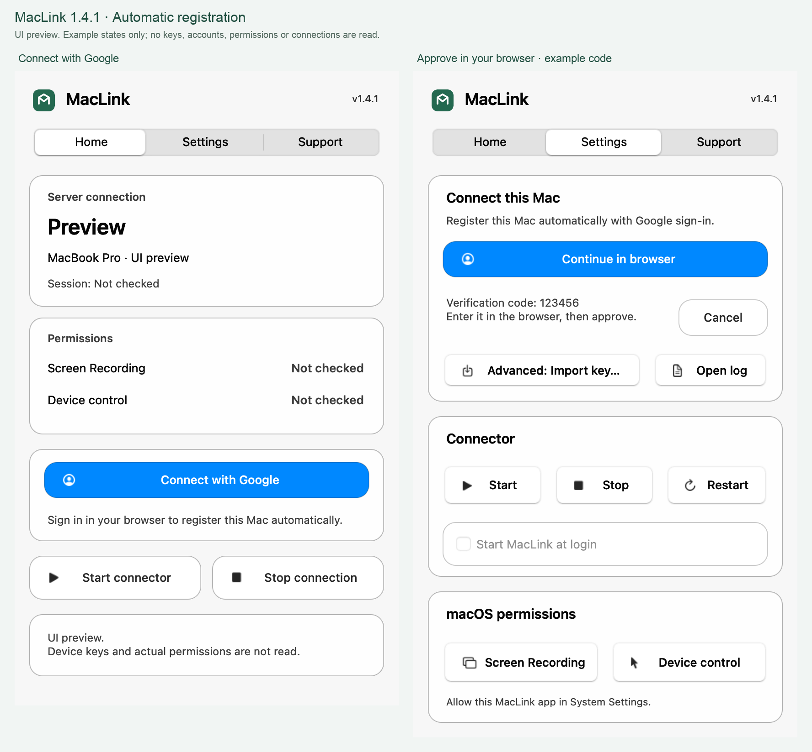

# MacLink

Access your Mac from anywhere with the same Google account.

Install the Connector on your Mac and register it to your Google account. Sign in to the same account on another computer and choose **My devices → Connect** to receive the screen and system sound and control the mouse and keyboard. Manage the host connection from the macOS menu bar app.

**Connector 1.4.1** · **English** / [한국어](README.ko.md)

[Website](https://www.maclink.cloud/) · [Download Connector](https://www.maclink.cloud/api/downloads/MacLink-Connector-arm64.dmg) · [Releases](https://github.com/fivebellhyun/MacLink/releases) · [License](LICENSE.md) · [Privacy Policy](https://www.maclink.cloud/privacy) · [Terms of Service](https://www.maclink.cloud/terms)

Developed by [fivebellhyun](https://github.com/fivebellhyun). You may modify and adapt the source for noncommercial use with attribution. Hosting and optional TURN services may incur separate costs.

## Quick Start

1. Download **MacLink Connector** from the [website](https://www.maclink.cloud/). Open the DMG, move **MacLink** to **Applications**, and launch it.
2. In the menu bar app, choose **Connect with Google**. The MacLink registration page opens in your browser.
3. Sign in with Google, check the Mac name, enter the six-digit code shown in the Connector, and approve registration.
4. Allow **Screen & System Audio Recording** and **Device Control & Data Access** in macOS System Settings. Restart the Connector if prompted, then wait for the Mac to appear online under **My devices**.
5. On another computer, sign in to the **same Google account** and choose **Connect** on your online Mac.

A configured Connector keeps its existing registration after restarting or updating. A device that has never connected is shown as **Setup in progress**, rather than as an ordinary offline device.

The remote computer only needs a compatible browser. The host Mac must be **awake and running the Connector**.

The downloadable Connector currently targets **Apple M-series Macs (Apple silicon, arm64)** running **macOS 13 or later**.

<details>
<summary>View the setup guide</summary>


</details>

## Menu Bar App

Manage the connection from the MacLink icon in the macOS menu bar.



*English UI preview of Connector 1.4.1 automatic registration. The code and statuses are examples; no live account, permission or connection data is read.*

| Tab | What you can do |
| --- | --- |
| Home | Check server connection, session status, Screen Recording and Device control permissions; reconnect or stop the Connector. |
| Settings | Connect with Google, open logs, start or restart the Connector, enable launch at login, open macOS permission settings, and select a language. Manual key import remains available for development. |

**Device control** in MacLink corresponds to the macOS **Device Control & Data Access** permission. Depending on the macOS version, Screen Recording appears as **Screen & System Audio Recording**.

To update, quit MacLink, replace the installed app with the app from the latest DMG, and launch it again. Device settings are stored in `~/Library/Application Support/MacLink`. After replacing the build, grant macOS permissions again.

The current release uses an ad-hoc signature and has no Developer ID signature or notarization. If macOS blocks a downloaded app, verify its source and use the standard approval process under **Privacy & Security**.

## Features

| Feature | Description |
| --- | --- |
| Browser access | View the Mac's primary display and send mouse and keyboard input without installing a viewer app. |
| Menu bar Connector | Manage connections, permissions, logs and launch at login from the macOS app. |
| Account-owned access | Registered Macs are accessible only from a browser signed in to the same Google account. |
| System sound | Send the Mac's system audio over WebRTC. The microphone is not captured. |
| View-only mode | Share the screen without granting mouse or keyboard control. |
| WebRTC streaming | Connect directly or use an optional TURN relay. |
| Windows keyboard mapping | Map Windows Ctrl shortcuts to Mac Command or configure modifier keys individually. |
| Quality presets | Select capture width, target frame rate and WebRTC encoder bitrate together. Ultra targets a maximum width of 2560 px at 60 fps. |

## Comparison with Paid Services

This table compares selected single-user paid plans. The amounts below are the South Korean won (KRW) examples listed in the Korean document. Prices vary by region, discounts and taxes; check the official [TeamViewer pricing](https://www.teamviewer.com/ko/pricing/overview/) and [AnyDesk pricing](https://anydesk.com/ko/pricing) before purchasing.

| | MacLink | TeamViewer Remote Access | AnyDesk Solo |
| --- | --- | --- | --- |
| Software price | **Free for permitted noncommercial use** | **KRW 16,900/month** | **KRW 43,000/month** |
| Annual payment | Free for permitted noncommercial use | KRW 202,800/year | KRW 520,000/year |
| Billing | Free | Annual billing, taxes excluded | Annual billing, VAT excluded |
| Licensed users | No per-user software fee | 1 | 1 |
| Concurrent connections | One remote user per Mac | 1 channel, up to 3 session tabs | 1 connection; Solo does not support adding concurrent connections |
| Unattended devices | Register up to 8 Macs per owner account | 3 | 100 |
| Source and modification | Source available under the [project license](LICENSE.md) | See the provider's license terms | See the provider's license terms |

MacLink is free for permitted noncommercial use with attribution; commercial use requires separate written permission. Website hosting, storage and optional TURN traffic may incur additional costs. MacLink currently supports one primary display and one remote user per Mac, plus system audio. Dedicated file transfer is not provided. See the [license](LICENSE.md), [device/session implementation](MackLink_Web/lib/server.ts) and [limitations](#limitations).

## Usage

### Connect to My Devices with the Same Account

Open the [website](https://www.maclink.cloud/) on another computer and sign in to the **same Google account** used to register the Mac. Under **My devices**, choose **Connect** on an online Mac. You can select view-only or control access and the connection method. There are no invitation links to issue or enter, and no separate host-email check.

Use the sound button in the remote viewer to enable or mute system audio. If the browser blocks autoplay, click the sound button to start playback. The Mac needs **Screen & System Audio Recording** permission and the updated Connector; the microphone is not transmitted. On a supporting Connector, muting also stops host capture, Opus encoding and audio transmission. The website displays this only after the host acknowledges it. Older Connectors mute browser playback only. PCM playback starts with a separate button.

With **Ultra**, a supporting browser plays **48 kHz stereo, 32-bit floating-point PCM** without compression, using approximately **3.1 Mbps** in addition to video. Other presets and PCM fallback use music-oriented **192 kbps Opus**. The sound indicator shows the format actually playing. PCM avoids applying a lossy codec to the captured samples. macOS mixing and resampling, playback devices and network loss still affect what you hear; this does not copy the original music file bit for bit.

**Disconnect** ends the current connection. **Sign out** or login expiry also ends remote connections bound to that login. Removing a device invalidates its Connector key and deletes related sessions.

### Keyboard, Quality and Fullscreen

Open **Settings** in the remote viewer to adjust keyboard mapping and capture quality.

| Setting | Behavior |
| --- | --- |
| Swap Ctrl and Command | Send Windows Ctrl+C, Ctrl+V and Ctrl+Z as Mac Command shortcuts. |
| Individual modifiers | Remap or disable Ctrl, Windows/Command, Alt/Option and Shift individually. |
| Fast / Balanced / Sharp / Ultra | Select capture and WebRTC encoder targets. Actual quality depends on hardware, network conditions and the connection path. |
| Fullscreen | Display the remote screen in fullscreen. Press Escape to return to the toolbar. |

The local operating system or browser may handle reserved shortcuts before MacLink receives them. Refreshing the same browser tab can restore the connection using that tab's session storage. On another browser or computer, sign in to the same account and start a new connection from My devices.

| Preset | Maximum capture width | Target frame rate | WebRTC encoder target / ceiling |
| --- | --- | --- | --- |
| Fast | 1600 px | 15 fps | 2 / 4 Mbps |
| Balanced | 1600 px | 24 fps | 4 / 8 Mbps |
| Sharp | 2560 px | 30 fps | 8 / 16 Mbps |
| Ultra | 2560 px | 60 fps | 16 / 40 Mbps |

Capture preserves the source aspect ratio. **Ultra targets a maximum capture width of 2560 px at 60 fps; it does not guarantee sustained 60 fps, lossless video or a constant 40 Mbps.** Codec alignment may round odd dimensions down to even dimensions. The encoder target and ceiling are settings, not measured throughput. WebRTC congestion control may lower the bitrate, and the browser, negotiated codec, Mac performance and network also affect the result. See the [capture profiles](MacLink_Connector/quality.py).

### Keep Remote Access Available

Enable **Start MacLink at login** in Connector Settings. This starts the app after macOS login; it does not unlock FileVault or provide access before login.

The running Connector uses `caffeinate -di` to prevent automatic idle sleep. Closing the lid or manually putting the Mac to sleep may interrupt the connection. For unattended access, keep the Mac awake with its lid open and power connected.

## Connection Paths

The Connector makes outbound HTTPS requests for registration status, authorization checks and WebRTC signaling. It captures the Mac display and processes authorized input through native macOS APIs.

| Connection | Screen/input path | Notes |
| --- | --- | --- |
| Direct WebRTC | Encrypted video and data channels between the browser and Mac | Preferred when the network permits a connection. |
| WebRTC with TURN | An optional TURN service relays encrypted WebRTC packets | Helps on restricted networks and may incur relay costs. |

The website uses React/Sites/Vinext, Cloudflare Workers and D1. Owners can configure their own Cloudflare TURN account under **Connection settings**. Automatic mode tries available WebRTC paths and, when TURN is configured, makes one additional browser-side TURN/TLS 443 attempt. If both paths are blocked, it reports connection failure.

The Connector itself currently uses STUN rather than native TURN. Browser-side TURN cannot guarantee connectivity if the Mac's network also blocks outbound UDP. HTTP-only proxies or managed network policies may also block TLS 443.

<details>
<summary>View the connection diagrams</summary>


</details>

## Security and Data Handling

| Item | Current behavior |
| --- | --- |
| Device ownership | Google subject identifiers and device ownership are checked. Access requires a valid login session for the same account. Device and session secrets are stored as hashes. |
| Login-session binding | Remote sessions are bound to the Google login that initiated them. A session token alone does not grant access; signing out or login expiry ends authorization. |
| Access scope | The server and Connector enforce view-only and control permissions. Native input also requires macOS Accessibility permission. |
| Authorization refresh | Connector 1.4.1 normally polls every four seconds. After 17 seconds without fresh authorization, it pauses screen/system-sound transmission and input. The existing peer can be retained for up to 30 seconds from the last confirmation. |
| Revocation and recovery | Explicit revocation, session or transport generation changes, and loss of macOS permissions close the previous connection. Resuming requires fresh authorization for the current session. |
| WebRTC | Video, system sound and input use encrypted WebRTC transport. |
| Local credentials | The automatically configured device key is stored under `~/Library/Application Support/MacLink`; protect it like a password. Remote input text is not written to Connector logs. |

Google sign-in does not link an older account merely because its email address matches. To bring a device from an older account into your current Google account, choose **My devices → Import device with existing connection key**, select the key JSON and confirm. Previous remote sessions end, so reconnect from My devices. Devices registered to another Google account cannot be imported. The older account's TURN settings are not copied; configure them again under **Connection settings**.

Keep your Google account, device key, session tokens and TURN secrets secure. A public link or email address alone cannot grant device access. Choose view-only when control is unnecessary, then disconnect or sign out after use.

When deploying your own server, retain trusted owner authentication and set the server-only `TURN_CONFIG_KEY` to a cryptographically secure random 64-character hexadecimal value. Keep the same key across deployments so stored TURN credentials remain decryptable. Do not blindly trust owner-authentication headers sent directly by public clients.

## Development

```bash
git clone https://github.com/fivebellhyun/MacLink.git
cd MacLink
```

### Build the macOS App

Build on macOS with Python **3.11–3.14**. The selected Python distribution and native dependencies must support macOS 13. The build checks the minimum supported macOS version of Mach-O binaries bundled in the app.

```bash
bash scripts/build-macos-app.sh

# Specify a compatible Python installation if needed.
MACLINK_BUILD_PYTHON=/path/to/python3 bash scripts/build-macos-app.sh
```

The script bundles Python and dependencies with PyInstaller, runs the app self-test and code-signature verification, then creates `dist/MacLink.app`, an architecture-specific DMG and a SHA-256 file. It does not publish a release. Adding `--install` copies the app to `~/Applications` if no existing app is present; it does not launch the app or enable launch at login.

After a maintainer publishes the DMG and checksum file to GitHub Releases, you can download and verify them with the repository's install script.

```bash
bash scripts/install-maclink.sh
```

Quit the running Connector before installing or updating. The install script defaults to `~/Applications` and preserves the device key. Developer source launchers in `MacLink_Connector/` are also available; stop existing Terminal or LaunchAgent instances before starting the menu bar app.

### Run the Website Locally

Use **Node.js 22.13 or later** and **pnpm 11.25.0**. Supply deployment-specific `.openai/hosting.json` settings in `MackLink_Web/`; the storage name must match the server's `DB` binding. This configuration file is not tracked in Git.

```bash
cd MackLink_Web
pnpm install --frozen-lockfile
pnpm dev
```

Local development uses Cloudflare emulation; actual sign-in requires Google OAuth configuration. See [Google login setup](docs/GOOGLE_LOGIN_SETUP.ko.md). Production requires real owner authentication, storage, secrets and hosting configuration. Moving to another runtime, such as AWS, also requires replacing these integrations.

```bash
# Run in MackLink_Web/ after preparing dependencies and hosting settings.
node --experimental-strip-types --experimental-sqlite --test tests/*.test.mjs
pnpm exec tsc --noEmit
pnpm build
```

After building the Connector, run its regression tests from the repository root.

```bash
.build/maclink/venv/bin/python -m unittest discover -s MackLink_Web/tests -p 'test_*.py'
```

### Project Structure

| Path | Contents |
| --- | --- |
| `MacLink_Connector/` | Native menu bar app, worker, screen capture, input, translations and local settings |
| `MackLink_Web/app/`, `MackLink_Web/components/` | Device management, connection flow, remote viewer and settings |
| `MackLink_Web/lib/` | Authorization, signaling, browser transport, keyboard mapping and TURN |
| `MackLink_Web/db/`, `MackLink_Web/drizzle/` | Database schema and cumulative migrations |
| `MackLink_Web/connector/` | Distribution copy of the native Connector source |
| `scripts/` | Build, installation and source synchronization |
| `MackLink_Web/tests/` | Web/API and native Connector tests |

After changing Connector source, synchronize the distribution copies with `python3 scripts/sync-connector.py`. Add `--check` to verify without writing files. For schema changes, add a new migration rather than modifying one already applied. See [Developer Notes](docs/DEVELOPER_NOTES.md) for implementation details.

## Troubleshooting

| Symptom | What to check |
| --- | --- |
| Setup in progress or persistently offline | Complete browser approval through **Connect with Google** in the Connector. For an existing registration, check the Connector status and log. |
| Another Connector is running | Stop the Connector running in an existing Terminal or login service before starting the menu bar app. |
| Permissions still required after approval | Check the installed MacLink app under macOS Privacy & Security, then quit and reopen it. You may need to remove the old app entry and add the current app again. |
| Screen works but input does not | Check control authorization and MacLink's Device Control & Data Access permission. Test mouse clicks and keyboard input separately. |
| Device missing or access denied | Check that you are using the Google account that registered the Mac, sign in again, and confirm that the Connector is online. |
| Connection repeatedly recovers | Check website/Connector compatibility, inspect the Connector log, and copy the remote viewer's connection diagnostics. |
| Cannot connect after reboot | Unlock FileVault and sign in on the Mac. Check launch at login, power, network and permissions. |

## Limitations

MacLink currently supports one primary display and one remote user per Mac. Dedicated file transfer, multi-monitor switching, Wake-on-LAN and pre-login/FileVault control are not implemented.

## Contributing

Help build MacLink with code, design, translation, documentation improvements and reproducible bug reports.

Before sharing logs or screenshots, remove device keys, session tokens and private screen content. Report security issues privately to the maintainer; do not post valid credentials or attack instructions in public issues.

## Community

- [Issues](https://github.com/fivebellhyun/MacLink/issues): bug reports and feature requests.
- [Pull requests](https://github.com/fivebellhyun/MacLink/pulls): code, design, translation and documentation improvements.
- [GitHub repository](https://github.com/fivebellhyun/MacLink): browse the source and star the project.

## License

MacLink uses the **MacLink NonCommercial Attribution License 1.0** (`LicenseRef-MacLink-NC-Attribution-1.0`). Noncommercial use, modification and redistribution are allowed with attribution to **fivebellhyun**. Commercial use requires separate written permission. You do not have to publish modified source.

This is source-available software with a noncommercial restriction. Third-party components retain their own licenses and notices. See [LICENSE.md](LICENSE.md) and [THIRD_PARTY_NOTICES.md](THIRD_PARTY_NOTICES.md) for the governing terms.
