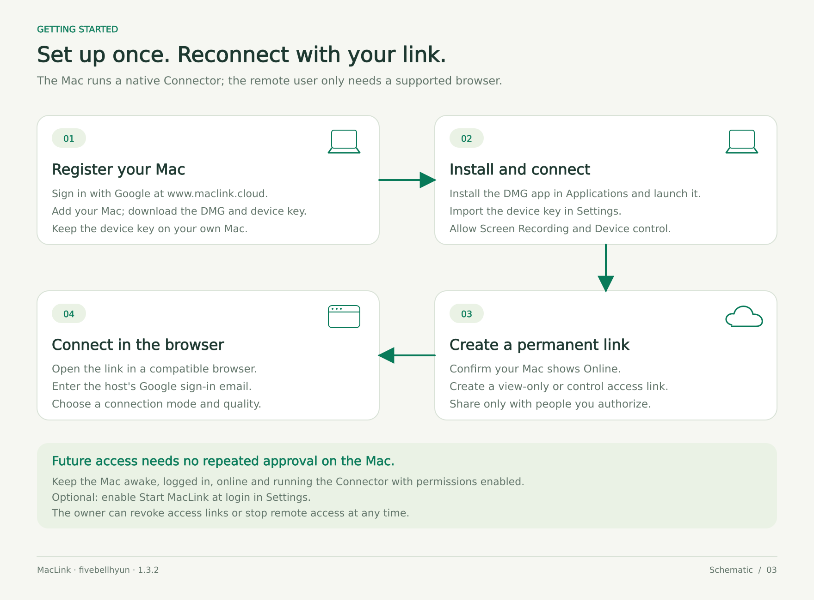
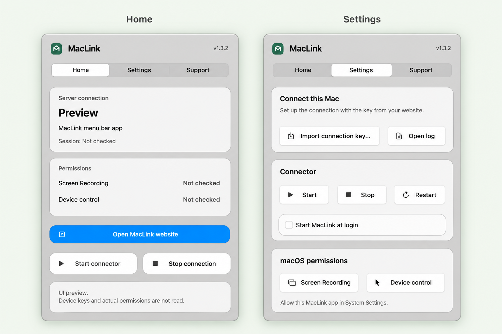
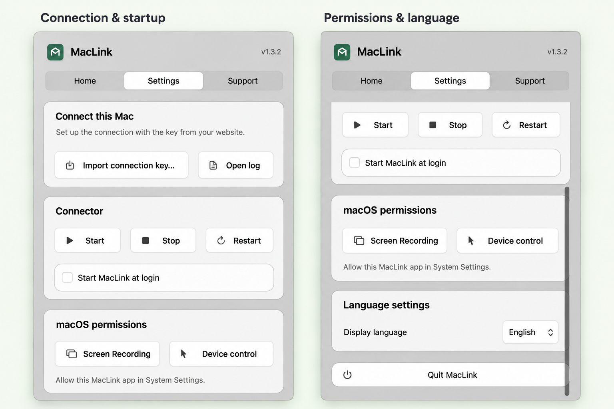
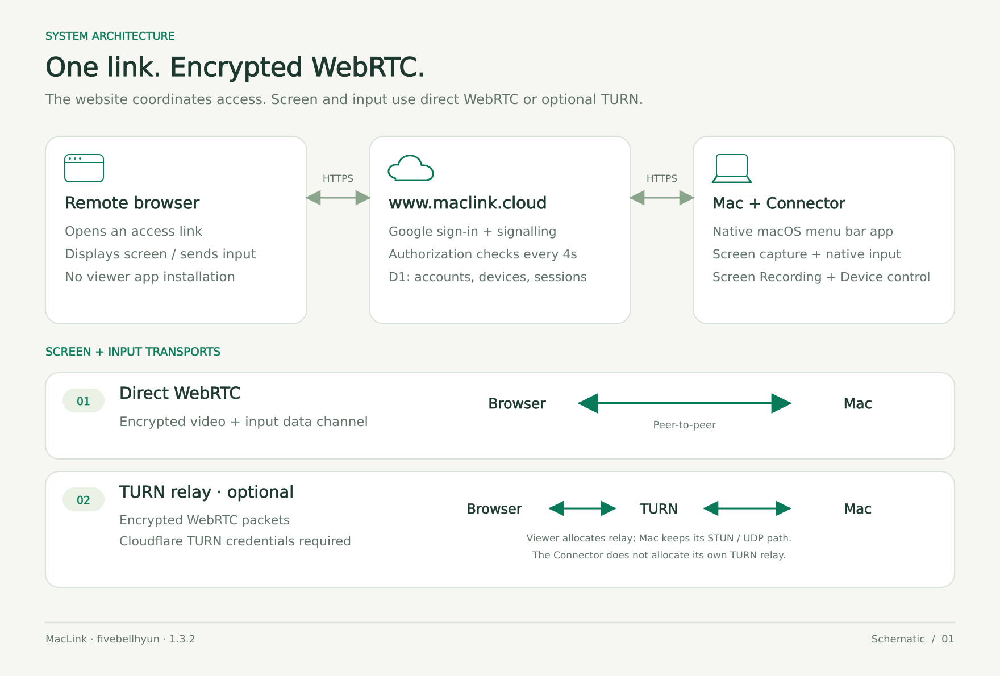
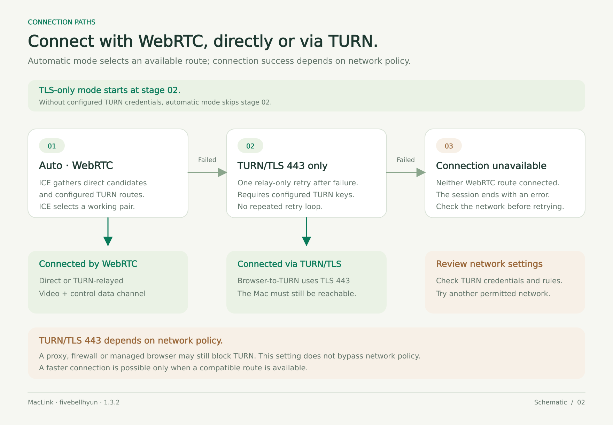

# MacLink

Access your Mac from a browser with a single link.

Install the Connector on your Mac, create an access link, and open it on another computer to view the screen or control the mouse and keyboard. Manage the host from a native macOS menu bar app.

**Connector 1.3.2** · **English** / [한국어](README.ko.md)

[Website](https://www.maclink.cloud/) · [Download Connector](https://www.maclink.cloud/api/downloads/MacLink-Connector-arm64.dmg) · [Releases](https://github.com/fivebellhyun/MacLink/releases) · [License](LICENSE.md) · [Privacy Policy](https://www.maclink.cloud/privacy) · [Terms of Service](https://www.maclink.cloud/terms)

Developed by [fivebellhyun](https://github.com/fivebellhyun). Source is available for review, modification, and noncommercial use with attribution. Hosting and optional TURN services may incur separate costs.

## Quick Start

1. Open the [MacLink website](https://www.maclink.cloud/) on your Mac, sign in with Google, and register your device under **My Devices**.
2. Download **MacLink Connector** and the device key, `maclink-config.json`.
3. Open `MacLink-Connector-arm64.dmg`, drag **MacLink** into **Applications**, and launch it.
4. Open the menu bar app, select **Settings**, and import the device key. Allow **Screen Recording** and **Accessibility** in macOS System Settings, then restart the Connector.
5. Confirm that the device is online, create an access link, and open it on the remote computer. Enter the **host's Google sign-in email address** to connect.

The remote computer only needs a compatible browser. Your Mac must remain **awake, logged in, connected to the internet, and running the Connector**.

The downloadable Connector targets **Apple M-series Macs (Apple silicon, arm64)** running **macOS 13 or later**. Python is bundled in the app; end users do not need Python, a source ZIP, or a Terminal session.

<details>
<summary>View the setup guide</summary>



</details>

## Desktop App (Menu Bar)

Manage the connection from the MacLink icon in the macOS menu bar.



*Home and Settings in Connector 1.3.2. Edited from English UI previews; the example states do not report live connections or permissions.*

| Tab | What you can do |
| --- | --- |
| Home | Check server connection, session status, Screen Recording, and Device control; reconnect or stop the Connector. |
| Settings | Import a device key, open logs, start or restart the Connector, enable launch at login, open macOS permission settings, and choose Korean or English. |

**Device control** in MacLink corresponds to the macOS **Accessibility** permission. Screen Recording may appear as **Screen & System Audio Recording** on some macOS versions; that label does not mean MacLink streams audio.



*Settings at two scroll positions: connect this Mac, control startup, open macOS permission settings, and choose a display language. These are edited UI previews.*

To update, quit MacLink, replace the installed app with the newer DMG version, and reopen it. Device configuration is stored in `~/Library/Application Support/MacLink`. macOS may require you to grant permissions again after replacing a build.

Release builds currently use ad-hoc signatures and are not Developer ID signed or notarized. If macOS blocks a downloaded build, review its origin and use the normal **Privacy & Security** approval flow.

## Features

| Feature | Description |
| --- | --- |
| Browser access | View your Mac's primary display and send mouse and keyboard input without installing a remote client. |
| Menu bar Connector | Manage connection, permissions, logs, and login startup from a native macOS app. |
| Persistent access links | Reconnect using the same link until the owner revokes it. |
| One-time invitations | Issue an invitation that expires after one hour and normally asks the Mac owner for approval. |
| View-only mode | Share the screen without granting mouse or keyboard control. |
| WebRTC streaming | Use a direct connection or an optional TURN relay. |
| Windows keyboard mapping | Map Windows Ctrl shortcuts to Mac Command or configure modifier keys individually. |
| Quality controls | Choose capture width, target frame rate, and WebRTC encoder bitrate together, up to a 2560-pixel width and 60 fps target. |

## vs. Paid Alternatives

A comparison with selected single-user paid plans, using the Korean README's KRW price examples. Regional prices, promotions and taxes can change; check the [TeamViewer pricing](https://www.teamviewer.com/ko/pricing/overview/) and [AnyDesk pricing](https://anydesk.com/ko/pricing) pages before purchasing.

| | MacLink | TeamViewer Remote Access | AnyDesk Solo |
| --- | --- | --- | --- |
| Software price | **Free for permitted noncommercial use** | **KRW 16,900/month** | **KRW 43,000/month** |
| Annual payment | Free for permitted noncommercial use | KRW 202,800/year | KRW 520,000/year |
| Billing | Free | Annually; tax excluded | Annually; VAT excluded |
| Licensed users | No per-user software fee | 1 | 1 |
| Concurrent connections | 1 remote user per Mac | 1 channel; up to 3 session tabs | 1; Solo cannot add concurrent connections |
| Unattended host devices | Up to 8 Macs per owner account | 3 | 100 |
| Source and customization | Available under the [project license](LICENSE.md) | See vendor license terms | See vendor license terms |

MacLink's free software price applies to permitted noncommercial use with attribution; commercial use requires separate written permission. Website hosting, storage, and optional TURN traffic may cost extra. MacLink currently provides one primary display and one remote user per Mac, without audio streaming or dedicated file transfer. See the [license](LICENSE.md), [device and session implementation](MackLink_Web/lib/server.ts), and [Limitations](#limitations).

## Usage

### Share an Access Link

Choose **view-only** or **control** access when creating an invitation. Send the complete link, including the `#join=` fragment, and tell the recipient which email address the host uses to sign in. On the hosted site, this is the host's Google sign-in email.

Persistent links have no expiry or usage limit until revoked, and do not ask for approval on the Mac each time. One-time invitations expire after one hour and normally require approval; the Connector can be configured to allow unattended requests.

**Disconnect** ends the current session. To invalidate shared links and ongoing sessions, revoke access under **My Devices**. Removing a device also invalidates its device key.

### Keyboard, Quality, and Fullscreen

Open **Settings** in the remote viewer to configure keyboard mapping and capture quality.

| Setting | Behavior |
| --- | --- |
| Swap Ctrl and Command | Send Windows Ctrl+C, Ctrl+V, and Ctrl+Z as Mac Command shortcuts. |
| Individual modifiers | Remap or disable Ctrl, Windows/Command, Alt/Option, and Shift. |
| Fast / Medium / Sharp / Ultra | Select capture and WebRTC encoder targets; actual quality depends on hardware, network, and transport. |
| Fullscreen | Show the remote display; press Escape to return to the toolbar. |

Shortcuts reserved by the local operating system or browser may be intercepted before MacLink receives them. Refreshing the same browser tab can recover a session using that tab's session storage; another browser or tab needs the invitation again.

| Preset | Maximum capture width | Target frame rate | WebRTC encoder target / ceiling |
| --- | --- | --- | --- |
| Fast | 1600 px | 15 fps | 2 / 4 Mbps |
| Medium | 1600 px | 24 fps | 4 / 8 Mbps |
| Sharp | 2560 px | 30 fps | 8 / 16 Mbps |
| Ultra | 2560 px | 60 fps | 16 / 40 Mbps |

Capture preserves the source aspect ratio and never upscales a smaller display. **Ultra targets a maximum capture width of 2560 pixels at 60 fps; it does not guarantee a sustained 60 fps, lossless video, or a constant 40 Mbps.** Codec alignment may round odd dimensions down. The encoder target and ceiling are settings, not measured throughput: WebRTC congestion feedback can lower the bitrate, and the browser, negotiated codec, host performance, and network can limit the result. See the [capture profiles](MacLink_Connector/quality.py).


### Keep Your Mac Available

Enable **Start MacLink at login** in Connector Settings. This starts the app after macOS login; it does not unlock FileVault or provide access before login.

The running Connector uses `caffeinate -di` to prevent automatic idle sleep. Closing the lid or manually putting the Mac to sleep can still interrupt access. For unattended use, keep the Mac awake with its lid open and power connected.

## Connection Paths

The Connector makes outbound HTTPS requests for registration status, authorization, and WebRTC signaling. It captures the Mac display and processes authorized input through native macOS APIs. No inbound HTTP port or manual port forwarding is required on the Mac.

| Connection | Screen and input path | Trade-off |
| --- | --- | --- |
| Direct WebRTC | Encrypted video and data channel between the browser and Mac. | Preferred when the networks permit a connection. |
| WebRTC with TURN | An optional TURN service relays encrypted WebRTC packets. | Helps on restricted networks and may incur relay costs. |

The website uses React/Sites/Vinext, Cloudflare Workers, and D1. An owner can configure a Cloudflare TURN account in **Connection Settings**. Automatic mode tries the available WebRTC paths, then a browser-side TURN/TLS 443 attempt when configured, and reports failure if neither path is available.

The Connector itself currently uses STUN rather than native TURN. Browser-side TURN does not guarantee connectivity if the Mac's network also blocks outbound UDP. TLS 443 can also be blocked by HTTP-only proxies or managed network policies.

<details>
<summary>View the connection architecture</summary>





</details>

## Security and Data Handling

| Area | Current behavior |
| --- | --- |
| Device ownership | Google OIDC sign-in protects device management. Owners are identified by Google `sub`; device, invitation, and session secrets are stored as hashes. |
| Host email check | A valid invitation must match the host's Google sign-in email. This checks the intended host; it is **not multi-factor authentication** or proof of the visitor's identity. |
| Access scope | The server and Connector enforce view-only versus control permissions. Native input also requires macOS Accessibility permission. |
| Authorization refresh | Connector 1.3.2 normally polls every four seconds. After 17 seconds without fresh authorization, it pauses screen transmission and input. The peer can be retained for up to 30 seconds from the last confirmation. |
| Revocation and recovery | Explicit revocation, a replaced session/generation, or lost macOS permissions closes the old connection. Resuming requires fresh authorization for the current session. |
| WebRTC | Video and input use encrypted WebRTC transport. |
| Local credentials | The imported device key is stored under `~/Library/Application Support/MacLink`; treat it like a password. Remote text is not written to Connector logs. |

Google sign-in does not automatically link a previous account by matching email addresses. To bring a legacy device into your current Google account, choose **My Devices → Import device with an existing key**, select its connection-key JSON, and confirm. The device’s previous invitations and sessions end, so create new invitation links. A key cannot import a device owned by a different Google account. Previous account TURN settings are not copied; configure TURN again in **Connection Settings**.


Keep device keys, access links, session tokens, and TURN secrets private. Anyone holding a persistent invitation and knowing the host email may connect without another approval on the Mac. Use view-only access when control is unnecessary, and revoke access when sharing ends.

Owner sign-in uses Google OpenID Connect with `state`, `nonce`, and PKCE. The server issues an opaque `HttpOnly` session cookie; Google `sub` identifies the owner. Sign-out uses a same-origin `POST /auth/signout` with an `Origin` check. When deploying your own server, configure the server-only `TURN_CONFIG_KEY` as a secure random 64-character hexadecimal value and keep it stable so saved TURN credentials remain decryptable.

## Development

```bash
git clone https://github.com/fivebellhyun/MacLink.git
cd MacLink
```

### Build the macOS App

Build on macOS with Python **3.11–3.14**. The chosen Python distribution and native dependencies must support macOS 13; the build checks the deployment targets of bundled Mach-O binaries.

```bash
bash scripts/build-macos-app.sh

# Optionally select a compatible Python installation.
MACLINK_BUILD_PYTHON=/path/to/python3 bash scripts/build-macos-app.sh
```

The script bundles Python and dependencies with PyInstaller, runs the app self-test, verifies the code signature, and creates `dist/MacLink.app`, an architecture-specific DMG, and its SHA-256 file. It does not publish a release. `--install` additionally copies the app to `~/Applications` if no copy exists there; it does not launch the app or enable login startup.

After a maintainer publishes matching DMG and checksum assets to GitHub Releases, the repository's installer can download and verify them:

```bash
bash scripts/install-maclink.sh
```

Quit an existing Connector before installing or updating. The installer defaults to `~/Applications` and preserves the device key. Developer source launchers in `MacLink_Connector/` remain available; stop old Terminal/LaunchAgent instances before starting the menu bar app.

### Run the Website Locally

Use **Node.js 22.13 or later** and **pnpm 11.25.0**. Supply deployment-specific `.openai/hosting.json` configuration in `MackLink_Web/`; its storage names must match the server's `DB` binding. This configuration is not tracked in Git.

```bash
cd MackLink_Web
pnpm install --frozen-lockfile
pnpm dev
```

Local development uses Cloudflare emulation. Owner sign-in uses the Google OIDC flow and server-managed session; local emulation does not authenticate an owner by itself. Production requires Google OAuth configuration, storage, secrets, and hosting configuration. Adapting the source to AWS or another runtime also requires configuring those integrations.

```bash
# From MackLink_Web/, after installing dependencies and configuring hosting.
node --experimental-strip-types --experimental-sqlite --test tests/*.test.mjs
pnpm exec tsc --noEmit
pnpm build
```

After building the Connector, run its regression tests from the repository root:

```bash
.build/maclink/venv/bin/python -m unittest discover -s MackLink_Web/tests -p 'test_*.py'
```

### Project Structure

| Path | Contents |
| --- | --- |
| `MacLink_Connector/` | Native menu bar app, worker, capture, input, localization, and local configuration. |
| `MackLink_Web/app/`, `MackLink_Web/components/` | Device management, access flow, remote viewer, and settings. |
| `MackLink_Web/lib/` | Authorization, signaling, browser transport, keyboard mapping, and TURN. |
| `MackLink_Web/db/`, `MackLink_Web/drizzle/` | Database schema and additive migrations. |
| `MackLink_Web/connector/` | Distribution copy of the native Connector source. |
| `scripts/` | Build, installer, and source synchronization. |
| `MackLink_Web/tests/` | Web/API and native Connector tests. |

After changing Connector source, synchronize the distribution copies with `python3 scripts/sync-connector.py`; add `--check` to verify without writing. Add a new migration for schema changes instead of modifying one already applied. Additional implementation details are in [Developer Notes](docs/DEVELOPER_NOTES.md).

## Troubleshooting

| Symptom | What to check |
| --- | --- |
| Mac stays offline | Start the Connector, check its log, and confirm that the imported key belongs to the registered device and website. |
| Another Connector is running | Stop the older Terminal or login-service instance before starting the menu bar app. |
| Permission still says required | Check the installed MacLink app in macOS Privacy & Security, then quit and reopen it. An older app entry may need to be removed and the current copy added again. |
| Screen works but input does not | Confirm control access and MacLink's Accessibility permission. Check keyboard input separately from mouse clicks. |
| Invitation is rejected | Use the complete link/code and the host's Google sign-in email. Ask the owner for a fresh invitation if access was revoked or expired. |
| Connection repeatedly recovers | Check that the website and Connector are compatible, inspect the Connector log, and copy the viewer's connection diagnostics. |
| Access fails after reboot | Unlock FileVault and log in on the Mac; check login startup, power, network, and permissions. |

## Limitations

MacLink currently supports one primary display and one remote user per Mac. Audio streaming, dedicated file transfer, multi-monitor switching, Wake-on-LAN, and pre-login/FileVault control are not implemented. Access to a locked Mac is not guaranteed. A sleeping or logged-out Mac cannot be reached through the Connector, and no commercial support SLA is provided.

## Contributing

Help improve MacLink through code, design, translation, documentation, or reproducible bug reports.

Remove device keys, invitation links, session tokens, and private screen content before sharing logs or screenshots. Report security issues privately to the maintainer rather than posting working credentials or exploit details in a public issue.

## Community

- [Issues](https://github.com/fivebellhyun/MacLink/issues): bug reports and feature requests.
- [Pull requests](https://github.com/fivebellhyun/MacLink/pulls): code, design, translation, and documentation improvements.
- [GitHub repository](https://github.com/fivebellhyun/MacLink): browse the source or star the project.

## License

MacLink uses the **MacLink NonCommercial Attribution License 1.0** (`LicenseRef-MacLink-NC-Attribution-1.0`). Noncommercial use, modification, and redistribution are permitted with attribution to **fivebellhyun**. Commercial use requires separate written permission. Publishing your modifications is not required.

This is source-available software with a noncommercial restriction. Third-party components retain their own licenses and notices. See [LICENSE.md](LICENSE.md) and [THIRD_PARTY_NOTICES.md](THIRD_PARTY_NOTICES.md) for the governing terms.
